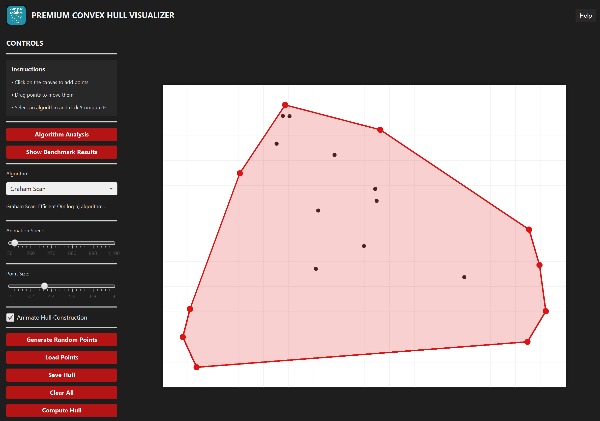
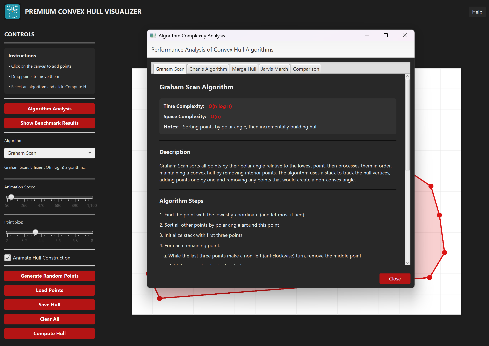
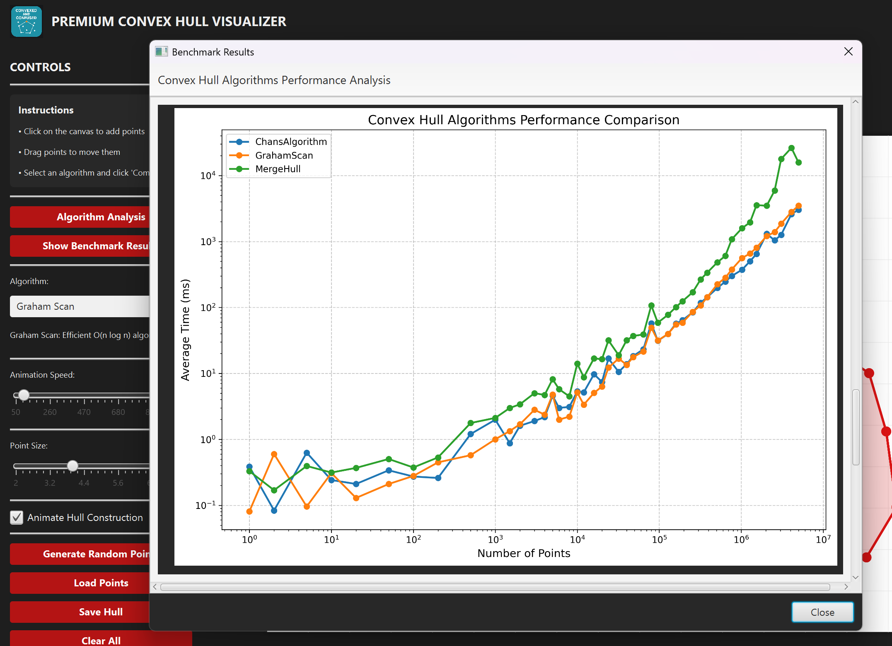
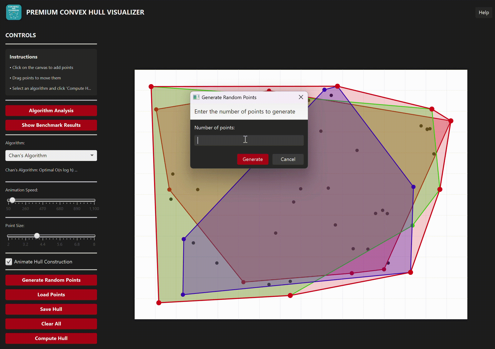
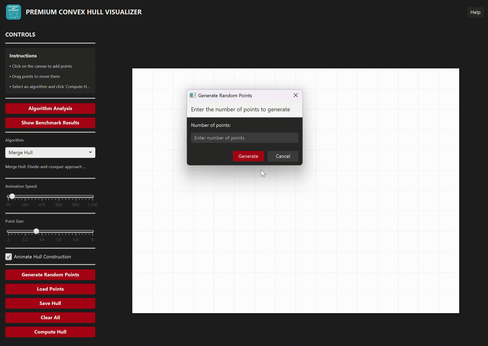

# Convex Hull Visualizer

A Java application for computing and visualizing convex hulls using various algorithms. The application provides an interactive interface for point input and hull computation, with support for multiple algorithms and visualization options.

## Features

- Interactive point input via mouse clicks
- Multiple convex hull algorithms:
  - Graham Scan (O(n log n))
  - Chan's Algorithm (O(n log h))
  - Merge Hull (O(n log n))
- Real-time visualization
- Animation of hull construction
- File I/O for point sets
- Performance benchmarking
- Complexity Analysis of the algorithms

## Requirements

- Java 11 or later
- JavaFX 17.0.2
- Maven

## Installation

1. Make sure maven is installed
  ```bash
   mvn -version
2. To build the project:
   ```bash
   mvn clean compile
   ```
3. To run the project:
   ```bash
   mvn javafx:run
   ```

## Usage

### Basic Usage

1. Launch the application
2. Click on the canvas to add points
3. Select an algorithm from the dropdown
4. Select animation speed and point size
5. Optionally select the checkbox to animate hull
6. Click "Compute" to calculate the hull
7. Use "Save" to export the hull points
8. Check complexity analysis under "Algorithm Analysis"
9. Check benchmark results under "Show Benchmark Results"

### Controls

- **Algorithm Selection**: Choose between Graham Scan, Chan's Algorithm, and Merge Hull
- **Animation**: Toggle hull construction animation
- **Speed**: Adjust animation speed (50-500ms)
- **Point Size**: Adjust the size of displayed points
- **File Operations**: 
  - Load: Import points from a text file
  - Save: Export hull points to a text file
  - Clear: Reset the canvas

### File Format

Points are stored in text files with one point per line:
```
x1 y1
x2 y2
...
```

## Screenshots


*Main application window with points and hull*


*Hull algorithm complexity explanation*


*Benchmark results*


*Chan algorithm animation*


*Merge Hull algorithm animation*

## Performance

The application includes built-in benchmarks for comparing algorithm performance:

```bash
mvn clean package
java -jar target/benchmarks.jar
```

Results are output to `benchmark_results.csv` for analysis.

## Contributing

1. Fork the repository
2. Create a feature branch
3. Commit your changes
4. Push to the branch
5. Create a Pull Request

## License

This project is licensed under the MIT License - see the [LICENSE](LICENSE) file for details.

## Acknowledgments

- Original algorithms by their respective authors
- JavaFX for the UI framework
- JMH for benchmarking support 